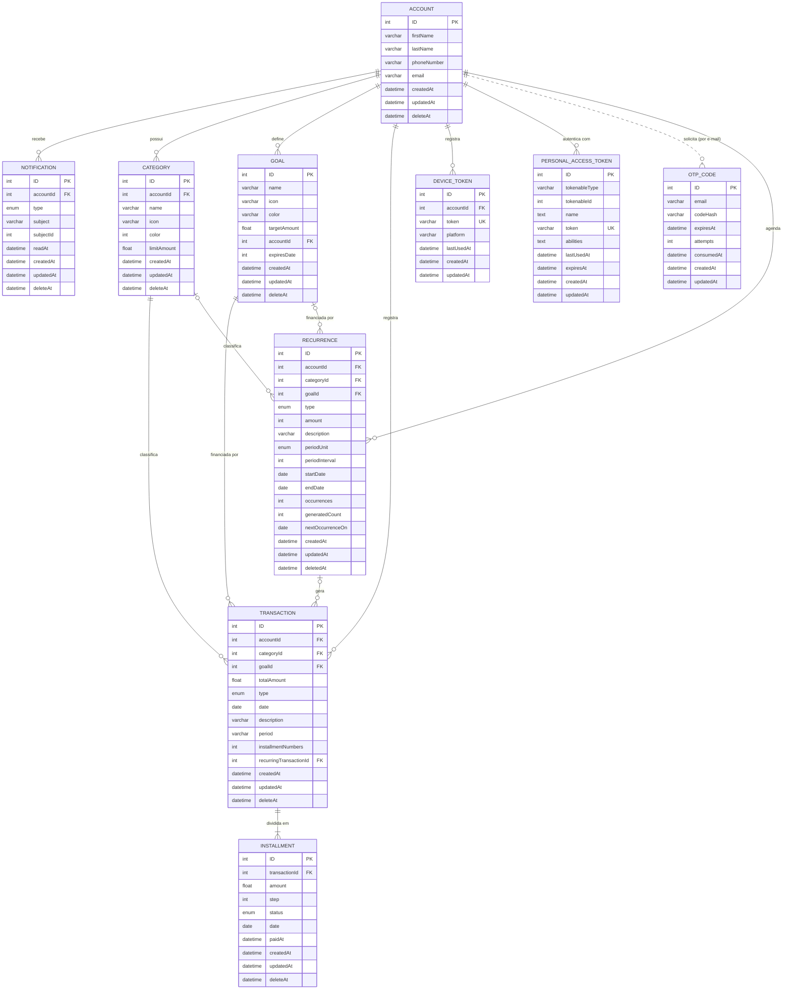

# FlowFi — Modelo de Dados (ERD)

Esquema-alvo do slice de domínio `Ledger` (mais notificações). Implementado
até agora: o slice `Identity` (`users`, `otp_codes`, `personal_access_tokens`)
e, do `Ledger`, `goals` e `categories`. Cada linha "Status" abaixo registra
como uma entidade do desenho foi concretizada.

`ACCOUNT` é a evolução do model `User` atual
(`packages/backend/app/Domains/Identity/Models/User.php`) — `name` dividido em
`firstName`/`lastName`, mais `phoneNumber`.

Status: `ACCOUNT` foi concretizada na tabela `users` já existente (sem
renomear) como `first_name`, `last_name`, `phone_number` e `deleted_at`
(`SoftDeletes`).

Status: `GOAL` foi concretizada como `goals`
(`app/Domains/Ledger/Models/Goal.php`): `accountId` → `user_id` (FK para
`users.id`, indexada), `targetAmount` → centavos inteiros em `target_amount`
(expostos como string decimal pelo cast `Money`), `expiresDate` → `date
expires_at` anulável, `color` → string `#RRGGBB`, `deleteAt` → `deleted_at`.
`name` é único por usuário entre as linhas ativas, garantido apenas na
validação (sem índice único no banco, então o nome de um registro com
soft delete pode ser reutilizado).

Status: `CATEGORY` foi concretizada como `categories`
(`app/Domains/Ledger/Models/Category.php`): `accountId` → `user_id` (FK para
`users.id`, indexada), `color` → string `#RRGGBB` (não `INT`), `deleteAt` →
`deleted_at`, mais uma coluna que não estava no desenho original,
`limitAmount` → centavos inteiros anuláveis em `limit_amount` via cast `Money`
(o máximo que o usuário quer destinar à categoria; null = sem limite). `name`
segue a mesma regra de unicidade por usuário de `GOAL`.

Status: `TRANSACTION` e `INSTALLMENT` foram concretizadas como `transactions`
e `installments` (`app/Domains/Ledger/Models/Transaction.php` e
`Installment.php`). `accountId` → `user_id` (FK, indexada, obrigatória);
`categoryId` → `category_id` (FK, indexada, obrigatória — mantida obrigatória,
ao contrário de `goalId`, já que nada no desenho original sugeria o
contrário); `goalId` → `goal_id` (FK, indexada, **anulável**, conforme o ponto
em aberto abaixo); `totalAmount`/`INSTALLMENT.amount` → centavos inteiros via
`Money`, conforme o ponto em aberto abaixo; `deleteAt` → `deleted_at` em
ambas. `type` é validado contra `Transaction::TYPES` (`income`, `expense`) —
uma suposição, já que o desenho original deixou os valores do enum
indefinidos. `period` virou o par `period_unit`
(`day`/`week`/`month`/`year`, `Transaction::PERIOD_UNITS`) + `period_interval`
(inteiro positivo), resolvendo o ponto em aberto "period também parece um
enum" e ainda permitindo, por exemplo, "a cada 15 dias".
`installmentNumbers` → `installments_count`, mantido como cache
desnormalizado escrito pelo `TransactionService` junto com as próprias
parcelas (veja o ponto em aberto abaixo sobre por que é uma duplicação
deliberada, não um descuido).

Uma coluna que não estava no desenho original: `schedule_type`
(`single`/`periodic`/`custom`) registra como o plano de parcelas atual foi
gerado — pagamento único, divisão igual em `installments_count` espaçada por
`period_unit`/`period_interval`, ou uma lista explícita de pares
`{amount, date}` com intervalos independentes e não uniformes entre si. É
isso que permite que `POST /transactions` e `PATCH /transactions/{id}`
suportem as três formas de pagamento: à vista, N parcelas iguais em cadência
fixa, ou N parcelas em datas totalmente diferentes. `period_unit`/
`period_interval` só são preenchidos quando `schedule_type` é `periodic`;
são `null` para `single` e `custom`. Editar uma transação recalcula todo o
cronograma sempre que um campo que o afeta muda (valor, número de parcelas,
período ou uma lista explícita de parcelas), mas é recusado (422) assim que
qualquer parcela já tiver sido paga — veja
`TransactionService::guardAgainstPaidInstallments()`.

Três tabelas existem nas migrations sem estar no desenho original:

- `OTP_CODE` → `otp_codes` (`app/Domains/Identity/Models/OtpCode.php`): uma
  linha por código de login emitido. Identificada por `email` (indexado),
  **não** por uma FK `user_id` — um código pode ser solicitado antes de a
  conta existir, então o vínculo com `ACCOUNT` é lógico
  (`otp_codes.email` = `users.email`) e não tem constraint. Só o `code_hash`
  é armazenado; `attempts` limita as tentativas e `consumed_at` garante o
  uso único.
- `PERSONAL_ACCESS_TOKEN` → `personal_access_tokens` (Laravel Sanctum): os
  bearer tokens emitidos depois que um código é verificado. `tokenable_type` /
  `tokenable_id` é um ponteiro polimórfico (`morphs`), na prática sempre
  `User` — sem constraint de FK.
- `DEVICE_TOKEN` → `device_tokens`
  (`app/Domains/Notification/Models/DeviceToken.php`): tokens de registro do
  FCM usados para enviar notificações push. FK `user_id` (indexada, cascade
  no delete), `token` único globalmente, `platform` como string,
  `last_used_at` anulável. Sem soft delete.

Status: `RECURRENCE` foi concretizada como `recurring_transactions`
(`app/Domains/Ledger/Models/RecurringTransaction.php`). É um molde que gera
uma transação nova a cada período, sem fim obrigatório (salário, aluguel,
assinaturas, depósito mensal numa meta). Difere do parcelamento
(`schedule_type = periodic`), que divide **um** valor fechado em N parcelas
de **uma** transação: aqui `amount` se repete inteiro a cada ocorrência.
Colunas: `user_id` (FK, indexada, cascade no delete), `category_id` (FK
anulável, `nullOnDelete()`), `goal_id` (FK anulável, `nullOnDelete()`),
`type` (`Transaction::TYPES`), `amount` (centavos inteiros via `Money`),
`description` (anulável), `period_unit` (`Transaction::PERIOD_UNITS`) +
`period_interval` (inteiro positivo), `start_date` (date), `end_date` (date
anulável) **ou** `occurrences` (inteiro anulável) — nenhum dos dois = sem
fim —, `generated_count` + `next_occurrence_on` (date anulável, indexada;
null = encerrada), `timestamps` e `deleted_at`. Em `transactions` entra
`recurring_transaction_id` (FK anulável, indexada, `nullOnDelete()` — apagar
a recorrência preserva o histórico já gerado), com índice único em
`(recurring_transaction_id, date)` para que o job não duplique uma
ocorrência se rodar duas vezes no mesmo dia.

Fluxo: o comando `ledger:generate-recurring` roda todo dia às 00:10
(America/Sao_Paulo) e busca as recorrências com `next_occurrence_on <= hoje`;
para cada uma, o `RecurringTransactionService` cria a transação através do
`TransactionService` (com `schedule_type = single` e
`recurring_transaction_id` preenchido) e avança o cursor. A ocorrência *n* é
sempre calculada a partir de `start_date` (`start_date + n × período`, com
`addMonthsNoOverflow`), então o dia 31 não "escorrega". Quando a próxima data
passa de `end_date` ou `generated_count` chega a `occurrences`,
`next_occurrence_on` vira null e a recorrência deixa de gerar transações.
Encerrar (`PATCH /recurring-transactions/{id}/end`) faz o mesmo a partir de
hoje.

As tabelas exclusivas do framework (`sessions`, `password_reset_tokens`,
`cache`, `cache_locks`, `jobs`, `job_batches`, `failed_jobs`) são
infraestrutura do Laravel e ficam fora do diagrama de propósito.

## Cardinalidades

O diagrama original usa pares mín-máx; o par fica do lado que ele conta.

| Relacionamento | Leitura |
|---|---|
| ACCOUNT → NOTIFICATION | 1 conta tem 0..n notificações |
| ACCOUNT → CATEGORY | 1 conta tem 0..n categorias |
| ACCOUNT → GOAL | 1 conta tem 0..n metas |
| ACCOUNT → TRANSACTION | 1 conta tem 0..n transações |
| CATEGORY → TRANSACTION | 1 categoria classifica 0..n transações |
| GOAL → TRANSACTION | 1 meta é financiada por 0..n transações |
| TRANSACTION → INSTALLMENT | 1 transação se divide em 1..n parcelas |
| ACCOUNT → DEVICE_TOKEN | 1 conta tem 0..n tokens de dispositivo |
| ACCOUNT → PERSONAL_ACCESS_TOKEN | 1 conta tem 0..n tokens de acesso (polimórfico, sem FK) |
| ACCOUNT → OTP_CODE | 1 e-mail tem 0..n códigos OTP (vinculado pelo e-mail, sem FK) |
| ACCOUNT → RECURRENCE | 1 conta tem 0..n recorrências |
| CATEGORY → RECURRENCE | 1 categoria classifica 0..n recorrências (categoria opcional) |
| GOAL → RECURRENCE | 1 meta é financiada por 0..n recorrências (meta opcional) |
| RECURRENCE → TRANSACTION | 1 recorrência gera 0..n transações; 1 transação vem de 0..1 recorrência |

O par de `TRANSACTION → INSTALLMENT` é `(1,1) (1,n)`; a ferramenta usada no
diagrama original não conseguia representar `(1,n)` e mostrava `(0,n)` no
lugar.

## Diagrama

## Notas sobre posse dos dados

- `ACCOUNT` é a raiz do agregado. Toda entidade exceto `INSTALLMENT` carrega
  `accountId` — essa coluna é a chave de isolamento por tenant em todas as
  queries.
- `INSTALLMENT` só chega à conta através de `TRANSACTION`: o cronograma de
  pagamento é local à transação por design.
- `NOTIFICATION.subject` + `subjectId` é um ponteiro polimórfico (`morphTo`
  do Laravel, ou seja, `subject_type` / `subject_id`) — sem constraint de FK.
- `TRANSACTION` é o ponto de junção entre classificação (categoria), alocação
  (meta) e cronograma (parcelas).
- `OTP_CODE` e `PERSONAL_ACCESS_TOKEN` pertencem ao slice `Identity` (login
  por OTP + Sanctum); `DEVICE_TOKEN` pertence ao slice `Notification`. Das
  três, só `DEVICE_TOKEN` carrega uma FK `accountId`.
- `RECURRENCE` carrega `accountId` como as demais entidades do `Ledger`. As
  transações que ela gera são transações comuns, com o próprio `accountId`;
  `recurringTransactionId` só registra a origem.

## Pontos em aberto

- `deleteAt` deveria ser `deletedAt` (`deleted_at`) para o `SoftDeletes` do
  Laravel. Feito para `ACCOUNT` (`users.deleted_at`), `GOAL`
  (`goals.deleted_at`), `CATEGORY` (`categories.deleted_at`), `TRANSACTION`
  (`transactions.deleted_at`) e `INSTALLMENT` (`installments.deleted_at`).
- `GOAL.expiresDate` está tipado como `INT`, mas nomeado como data.
  Resolvido: `date expires_at` anulável.
- `color` é `INT` em `CATEGORY` e `VARCHAR` em `GOAL`. Resolvido para ambos
  como string `#RRGGBB`; os dois compartilham o `AppearanceService`. O
  diagrama mantém o `int` original em `CATEGORY` por fidelidade ao desenho de
  origem.
- As colunas monetárias (`GOAL.targetAmount`, `CATEGORY.limitAmount`,
  `TRANSACTION.totalAmount`, `INSTALLMENT.amount`) estão desenhadas como
  `FLOAT`. Resolvido para as quatro como centavos inteiros via o cast
  compartilhado `Money`, que agora também expõe `Money::toCents()`/
  `Money::toDecimal()` como helpers estáticos para que o
  `InstallmentPlanner` possa dividir e somar valores sem floats.
- `CATEGORY.limitAmount` não tem período associado (por mês? total?). Ainda
  em aberto — comparar os gastos com ele é trabalho futuro, fora deste slice.
- `TRANSACTION.goalId` está desenhado como obrigatório `(1,1)`; resolvido
  como anulável `(0,1)` (`goal_id` anulável, `nullOnDelete()`), já que a
  maioria das transações não tem meta. `category_id` continuou obrigatório.
- `TRANSACTION.installmentNumbers` duplica `COUNT(INSTALLMENT)`. Resolvido
  como desnormalização deliberada (`installments_count`): é sempre escrito
  pelo `TransactionService` na mesma transação de banco que substitui as
  parcelas, então nunca fica dessincronizado, e permite que a listagem de
  transações mostre a contagem sem carregar a relação `installments`.
- `TRANSACTION.period` é `VARCHAR` enquanto `type` é `ENUM`; period também
  parece um enum. Resolvido como `period_unit` (tipo enum,
  `Transaction::PERIOD_UNITS`) + `period_interval` (multiplicador inteiro).
- `ACCOUNT` não tem `password` / `email_verified_at`. Resolvido: `ACCOUNT`
  ficou em `users`; `password` foi removido (a autenticação é só por OTP, os
  códigos ficam em `otp_codes`) e `email_verified_at` foi mantido e é
  preenchido quando um código é verificado.
- Os valores do enum `TRANSACTION.type` nunca foram especificados no desenho
  original. Assumidos como `income` / `expense` (`Transaction::TYPES`) como
  o mínimo que o FlowFi precisa; revisitar se o produto pedir mais (ex.:
  transferência).
